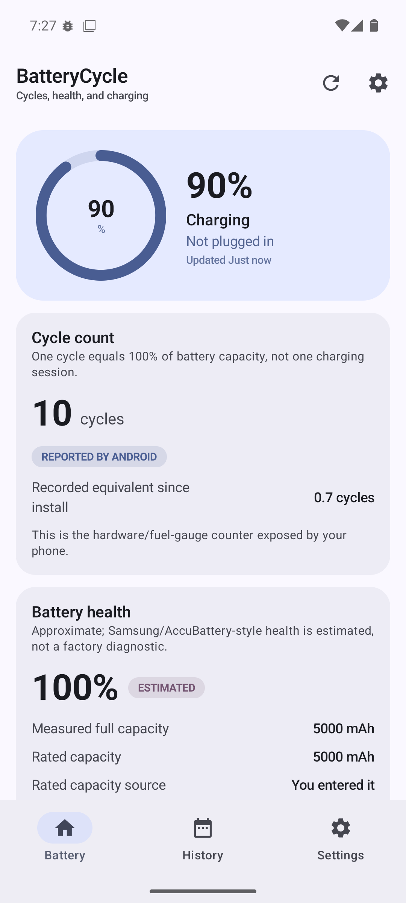
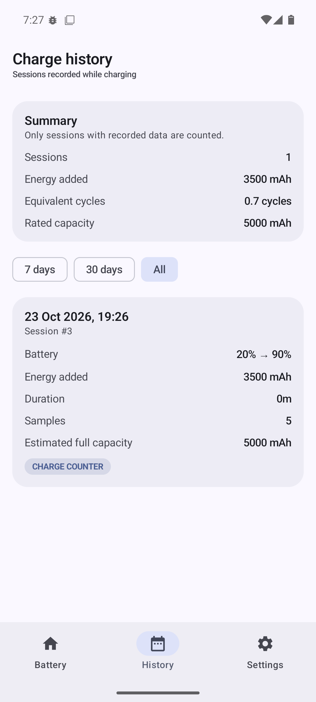
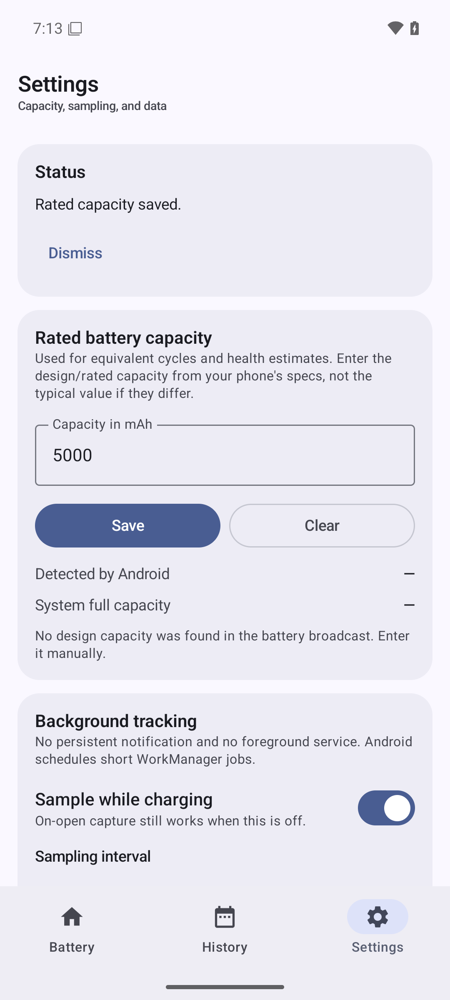
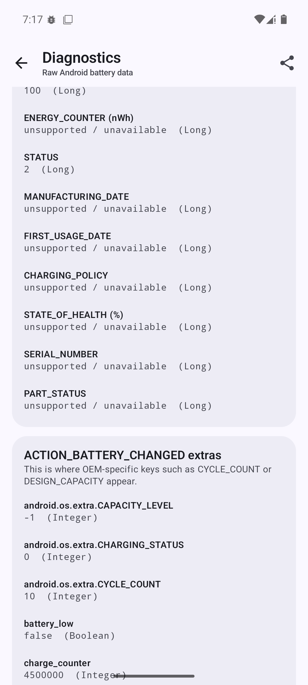

# BatteryCycle Releases

Free, signed APK releases for **BatteryCycle**, a local-only Android battery cycle and health tracker.

**[Download the latest APK](https://github.com/khanhnhanbk/battery-cycle-releases/releases/latest)**

The app source is private. This repository exists to distribute signed binaries, checksums, release notes, and the privacy policy.

## What it does

- Shows the phone's hardware cycle count when Android/OEM exposes it.
- Keeps a local charge-session history.
- Estimates full capacity and battery health after several charge samples.
- Shows live level, status, temperature, voltage, current, and charge counter.
- Has no account, ads, analytics, cloud sync, or `INTERNET` permission.
- Uses WorkManager while charging; **no persistent notification and no foreground service**.

## Requirements

- Android 8.0+ (`minSdk 26`).
- About 10 MB free space.
- A phone that allows installing apps from a browser/file manager.

## Install

1. Open the [latest release](https://github.com/khanhnhanbk/battery-cycle-releases/releases/latest).
2. Download `BatteryCycle-<version>.apk`.
3. Allow “Install unknown apps” for your browser/file manager when prompted.
4. Install and open BatteryCycle.
5. Go to **Settings → Rated battery capacity** and enter the phone's rated/design capacity if it is not detected.
6. Go to **Settings → Diagnostics** to see what the phone exposes.

### Updating

Download the newer APK and install it over the existing release. Android will keep local history for updates signed with the same key.

If you previously installed a **debug-signed** build, uninstall it first. Android rejects a differently signed package; uninstalling removes local history.

## Verify the download

Each release includes `SHA256SUMS.txt`. On Windows:

```powershell
Get-FileHash .\BatteryCycle-<version>.apk -Algorithm SHA256
```

Compare the result with the release notes/checksum file.

The release certificate SHA-256 for v0.1.1 and later is:

```text
123a0dd76be7fa32a1ab89c4b0d72b2f99218172b51860187ad4e266263a0d9d
```

If a future release uses a different signing certificate, the release notes will say so explicitly. Do not install an APK with an unexpected signer.

## Privacy

- Local-only Room database and preferences.
- No account, analytics, ads, or cloud.
- No `INTERNET` permission.
- Backups disabled (`allowBackup=false`); uninstalling removes history.
- Read [PRIVACY.md](PRIVACY.md).

## Known limitations

- Cycle count depends on OEM support. Honor `MTN-NX1` exposes a real count; some phones do not.
- Design capacity is not public; manual entry may be required.
- Health/capacity are estimates, not factory diagnostics.
- WorkManager sampling is coarse (about every 15 minutes while charging) and OEMs can delay it.
- GitHub and a future Google Play build may be different install channels.
- Oppo Find X9 has not been probed yet.

## Screenshots

| Dashboard | History |
|---|---|
|  |  |

| Settings | Diagnostics |
|---|---|
|  |  |

## Support

Open an issue in this repository for installation problems or release questions. Please include the phone model, Android version, BatteryCycle version, and the Diagnostics text if relevant.
